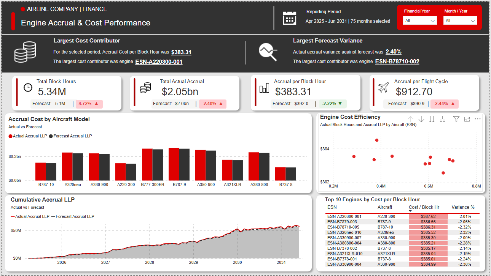

# Aircraft Engine Accrual & Cost Performance

A Power BI portfolio project exploring aircraft-engine accrual costs, utilisation and forecast performance across a synthetic multi-aircraft fleet.

> **Data notice:** All records in this project are synthetic and were created for portfolio demonstration purposes. They do not represent a real airline, fleet, engine configuration, maintenance event or financial result.

## Dashboard preview



## Business objective

The report is designed to help a finance or fleet-performance audience explore:

- Actual accrual cost compared with forecast accrual.
- Accrual cost per block hour and per flight cycle.
- Cost contribution by aircraft model.
- Engine-level cost efficiency and variance.
- Cumulative actual versus forecast accrual over time.
- The engines with the highest accrual cost per block hour.

## Dashboard contents

1. **Fleet KPIs** – total block hours, actual accrual, accrual cost per block hour and accrual cost per flight cycle.
2. **Aircraft comparison** – actual versus forecast accrual by aircraft model.
3. **Engine efficiency scatterplot** – actual block hours against accrual cost per block hour, with aircraft model categories.
4. **Top 10 engines** – ranked by accrual cost per block hour, with variance indicators.
5. **Cumulative trend** – actual versus forecast accrual over the selected reporting period.
6. **Dynamic reporting period** – responds to the financial-year and month/year selections.

## Data and model

The accompanying Excel workbook contains the synthetic star-schema dataset and model guide:

`data/synthetic-engine-maintenance-data.xlsx`

The model is organised around these tables:

- `Dim_Aircraft` – aircraft-level attributes.
- `Dim_Engine` – engine serial number and aircraft assignment.
- `Dim_Date` – calendar and financial-period attributes.
- `Fact_EngineMaintenance` – monthly engine maintenance, utilisation and accrual facts.

The intended relationships use one-to-many, single-direction filtering from dimensions to the fact table, with aircraft also related to the engine dimension.

See [Data model documentation](documentation/data-model.md) for the relationship outline.

## Example measures

The report uses DAX measures to aggregate actual and forecast accrual, block hours, cost rates and variance. Illustrative core measures are documented in [DAX measures](documentation/dax-measures.md).

## Tools and techniques

- Microsoft Power BI
- DAX
- Power Query
- Star-schema data modelling
- Dimensional modelling and relationships
- Interactive filtering and drill-down analysis
- Conditional formatting and data visualisation
- Excel

## Repository structure

```text
aircraft-engine-accrual-analysis/
├── README.md
├── dashboard/
│   └── (Power BI .pbix file to be added)
├── screenshots/
│   └── dashboard-overview.png
├── data/
│   └── synthetic-engine-maintenance-data.xlsx
└── documentation/
    ├── data-model.md
    └── dax-measures.md
```

## Author

**Augusto Terra**  
Business Intelligence & Data Analytics

- GitHub: [@augusto-terra10](https://github.com/augusto-terra10)
